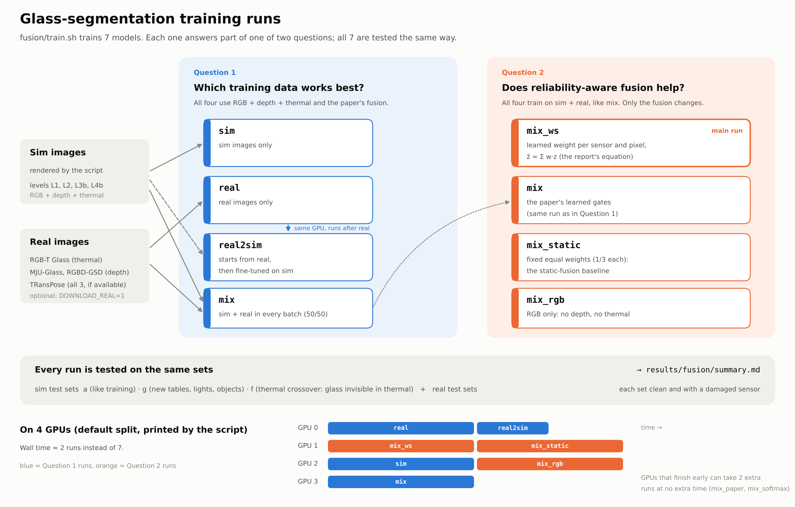

# Glass segmentation with reliability-aware fusion

This folder holds our glass segmentation model and everything needed to train it. The model is based on Huo et al.,
*Glass Segmentation with RGB-Thermal Image Pairs* (IEEE TIP 2023, [code](https://github.com/Dong-Huo/RGB-T-Glass-Segmentation)).
We extended it from RGB + thermal to RGB + depth + thermal, so it matches the sensors on our robot.

The model has two jobs. It finds the glass in the camera images, and along the way it decides how much to trust each
sensor in each part of the image. That second part is the reliability-aware fusion from the midterm report,
ẑ = Σ w_m z_m. Once trained, the model can replace the image encoder in Diffusion Policy.

All the code lives in `fusion/`. Nothing else in the repo was changed, and no other branch needs to be merged first
(more on that under [Branches](#branches)).

To run the training, see [`RUNNING.md`](RUNNING.md).



## How the model works

```
 rgb ────► ResNet ─┐
depth ───► ResNet ─┼─► fusion transformer ──► fused features ẑ ──► decoder ──► glass mask
thermal ─► ResNet ─┘    (picks a weight per sensor, per image patch)
```

Each sensor has its own ResNet-18 encoder, which turns the image into a grid of feature vectors, one per patch. The
fusion transformer then looks at all three sensors together and gives each sensor a weight for each patch. The fused
feature is the weighted sum of the three. Finally, the decoder enlarges this back to full resolution and outputs the
probability of glass at every pixel.

## What is changed from Huo et al.

- **Three sensors instead of two.** If a dataset is missing a sensor, the model simply ignores it (weight 0). That
  lets RGB-T, RGB-D and RGB-D-T datasets all train the same model.
- **Smaller encoders.** ResNet-18 instead of ResNet-50, to match Diffusion Policy. The paper's ResNet-50 is still
  available (`--backbone resnet50`).
- **Weights that actually track reliability.** In the initial tests, using Huo et al.'s gates didn't do this. They settled
  on one sensor, or on fixed weights, and stopped reacting to the input. Four changes fixed it:
  - `fusion_mode=weighted_sum`: the fused feature is Σ w·z, so each weight is that sensor's share.
  - Bounded gate scores (`gate_logit_max`), so a weight can't get stuck at 0 or 1.
  - Randomly damaging and dropping sensors during training (`Augment` in `data.py`).
  - A small extra loss that lowers a sensor's weight when we know it's bad (`--gate_sup`).
- **Reliability cues.** Each patch's token gets three simple statistics of the raw input added to it: brightness,
  contrast, and the fraction of valid pixels. This makes flat thermal and missing depth easy for the gate to spot.
- **An overlap (IoU) term in the loss.** The glass in our sim images is tiny, about 0.3% of the picture, and the
  paper's loss alone ends up predicting no glass at all.

The `mix_paper` run turns all of this off, so this version can be compared against the original fusion.

## Files

| file | contents |
|---|---|
| `model.py` | the network, the losses, and checkpoint loading |
| `data.py` | loading sim and real data, and the sensor damage used in training |
| `collect_sim.py` | renders sim images with exact glass masks |
| `train_seg.py` | trains one model and tests it |
| `evaluate.py` | the test metrics |
| `summarize.py` | builds the results table |
| `policy_encoder.py`, `config/train_glass_fusion_image.yaml` | the model as a Diffusion Policy image encoder |
| `train.sh` | runs everything, start to finish |
| `test_fusion.py` | quick tests that run on a CPU |
| `RUNNING.md` | how to run it and how to read the results |

## The experiments

`train.sh` trains seven models (the diagram above). Four of them compare training data:

- `sim`: sim only
- `real`: real only
- `real2sim`: real, then fine-tuned on sim
- `mix`: both together

The other three compare fusion designs against `mix`:

- `mix_ws`: our reliability-aware version
- `mix_static`: fixed equal weights
- `mix_rgb`: RGB only

All seven are tested on the same sim and real test sets, both as-is and with one sensor damaged on purpose.

Real robot data can be added as an additional dataset once we record it. 

## A quick check on CPU

A small version of the model can be run on CPU: 40 L4b episodes, 900 training steps, one fusion layer. The
numbers below are on 10 test episodes. This is mostly useful for seeing how the weights behav and the IoU differences
are within noise at this scale.

| fusion | IoU (loc), clean | IoU (loc), depth holes | weights rgb / depth / thermal | thermal weight when thermal is blanked | depth weight with depth holes |
|---|---|---|---|---|---|
| paper, sigmoid | 0.34 (0.99) | 0.24 (0.88) | 0.73 / 0.73 / 0.00 | 0.00 → 0.00 | 0.73 → 0.70 |
| paper, softmax | 0.35 (0.99) | 0.25 (0.83) | 1.00 / 0.00 / 0.00 | 0.00 → 0.00 | 0.00 → 0.00 |
| weighted sum + bounded scores + dropout | 0.33 (0.98) | 0.21 (0.81) | 0.33 / 0.33 / 0.33 | 0.33 → 0.33 | 0.33 → 0.33 |
| the above + gate loss (`mix_ws`) | 0.32 (0.99) | 0.25 (0.88) | 0.38 / 0.38 / 0.24 | 0.24 → 0.00 | 0.38 → 0.15 |

loc is the share of images where the model's most confident pixel is on the glass.

Only the last version has weights that respond to the input. Blanking thermal sends its weight to zero, and depth
holes shift weight away from depth, even though depth holes are never labelled in the gate loss. It also loses the
least accuracy when depth is damaged. Thermal still gets very little weight on the glass itself here; the full runs
should show whether that changes with more data.

## Using it in the policy

`FusionObsEncoder` in `policy_encoder.py` takes the place of Diffusion Policy's usual encoder (one ResNet per
camera, concatenated). For each frame it gives the policy:

- the fused features, averaged over the image;
- the fused features averaged over the predicted glass;
- where the glass is and how big it is;
- the current weight of each sensor.

The policy stage of `train.sh` trains Diffusion Policy on L4b with this encoder, starting from one of the
segmentation runs. It uses the same settings as the L4b sweep on `sim/hard-scenario`, so the success rates can be
compared directly. Details are in `RUNNING.md`, step 7.

## Branches

The real-data loader is already in `main` (PR #5), so this branch has it.

The harder sim levels (L1–L4b) are still on `sim/hard-scenario`, and this branch doesn't need them merged.
`train.sh` checks that branch out into a separate folder, `data/worktrees/sim_hard`, and only uses it to render
images. Git ignores `data/`, so the branch itself stays clean. After `sim/hard-scenario` is merged into `main`,
running `git merge origin/main` here is enough, and `train.sh` will switch to the merged sim by itself.

The pretrained thermal encoder on `encoder/thermal_pretrain` is optional. It can be loaded with `INIT_THERMAL`.
