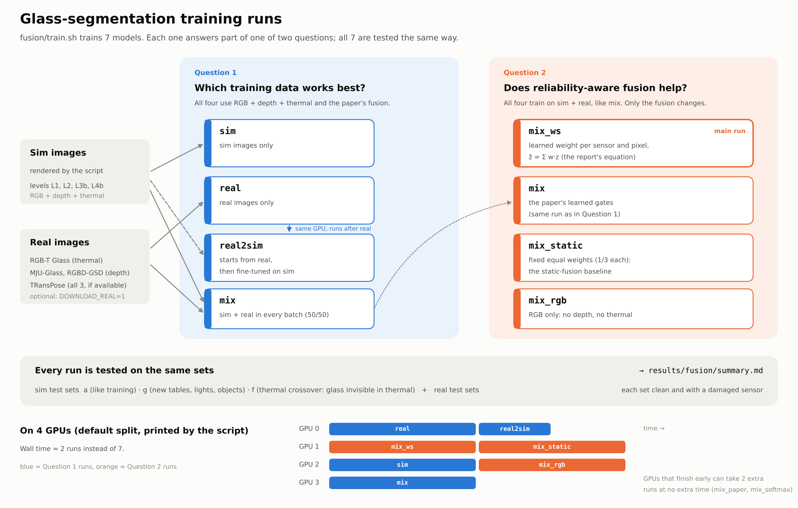

# How to run the glass-fusion training



## What you are running

`fusion/train.sh` trains seven glass-segmentation models and tests them all the same way. Together they answer two
questions:

- **Question 1: which training data works best?** Compare `sim`, `real`, `real2sim` and `mix`.
- **Question 2: does reliability-aware fusion help?** Compare `mix_ws` (the main model), `mix`, `mix_static`
  and `mix_rgb`.

| run | trains on | sensors | how the sensors are combined |
|---|---|---|---|
| `mix_ws` | sim + real | RGB, depth, thermal | **learned weight per sensor and pixel (main model)** |
| `sim` | sim only | RGB, depth, thermal | the paper's learned gates |
| `real` | real only | RGB, depth, thermal | the paper's learned gates |
| `real2sim` | real first, then sim | RGB, depth, thermal | the paper's learned gates |
| `mix` | sim + real | RGB, depth, thermal | the paper's learned gates |
| `mix_static` | sim + real | RGB, depth, thermal | fixed equal weights (baseline) |
| `mix_rgb` | sim + real | RGB only | none |

## Step 1: Set up 

**1. Get the code.** Only this branch is needed because the script fetches the harder sim by itself in step 3. 

```bash
git clone https://github.com/s-kumar72/multimodal-transparent-object-manipulation.git
cd multimodal-transparent-object-manipulation
git checkout policy/learned-attention-weighting
```

**2. Install the packages** into the project's usual Python 3.11 environment:

```bash
pip install -r sim/requirements.txt -r real_data/requirements.txt pyyaml
```

**3. Run the tests.** This takes about a minute and needs no GPU:

```bash
python -m fusion.test_fusion
```

You should see six lines starting with `ok`. 

## Step 2: Get the real data (optional)

Without real data, only the sim runs happen (`sim_ws`, `sim`, `sim_static`, `sim_rgb`), and Question 1 cannot be
answered. Pick one:

- **Download it**:

  ```bash
  STAGES="setup real" DOWNLOAD_REAL=1 bash fusion/train.sh
  ```

- **Use a copy someone already converted:**

  ```bash
  export TRANSPARENT_DATA_ROOT=/path/to/unified    # the folder that contains manifest.parquet
  ```

TRansPose is the most useful real dataset (tabletop glassware with all three sensors), but it needs a request form;
see `real_data/README.md`. Everything works without it.

## [OPTIONAL] Step 3: Do a short speed test (10 minutes)

```bash
N_TRAIN_EPS=20 N_VAL_EPS=4 N_TEST_EPS=5 ITERS=500 RUNS=sim DATA=data/fusion_speedtest bash fusion/train.sh
```

Look for lines like this:

```
it    500/500  loss 2.29  14.2 it/s  gates rgb 0.38 depth 0.35 thermal 0.27
```

A full run is 20,000 iterations. At 14 it/s that is about 25 minutes per run. Then delete the test folder:

```bash
rm -rf data/fusion_speedtest
```

## Step 4: Run everything

Start it in `tmux` (or `screen`, or a batch job):

```bash
tmux new -s fusion
bash fusion/train.sh
```

The script does these stages in order:

1. **Setup** (1 minute): checks packages, GPUs and rendering. It also checks out the `sim/hard-scenario` branch into
   `data/worktrees/sim_hard`. That is a separate folder git ignores, so this branch is not changed.
2. **Sim data** (15–60 minutes, uses all CPU cores): renders about 17,600 training images from the four simulation
   levels, plus test images.
3. **Real data check**: uses the real data from step 2 if it is there.
4. **Training**: trains the seven models, one queue per GPU, in parallel.
5. **Summary**: writes all results into `results/fusion/summary.md`.

### With 4 GPUs

All visible GPUs are used automatically. The script prints which runs go where:

```
GPU 0: real real2sim      GPU 1: mix_ws mix_static      GPU 2: sim mix_rgb      GPU 3: mix
```

The training stage then takes about as long as two runs (one hour at 25 minutes per run). `real2sim` always runs
right after `real` on the same GPU, because it starts from `real`'s result.

GPU 3 finishes early. You can give it two extra comparisons at no extra time:

```bash
RUNS="mix_ws sim real real2sim mix mix_static mix_rgb mix_paper mix_softmax" bash fusion/train.sh
```

To use only some GPUs: `GPUS="2 3" bash fusion/train.sh`. On a single GPU the runs go one after another.

### Watching it

| to see | run |
|---|---|
| that all GPUs are busy | `watch -n 5 nvidia-smi` |
| one GPU's training progress | `tail -f data/fusion/logs/seg_gpu0_*.log` |
| the overall progress | `tail -f data/fusion/logs/train_*.log` |

### If it stops

Run the same command again. Finished work is kept: the sim images, and every run that has a `final.json`. Any run that
was cut off part-way starts over. If one GPU's queue fails, the others keep going, and the script prints a warning at
the end.

## Step 5: Send the results back

```bash
tar czf fusion_results.tgz results/fusion data/fusion/logs \
    data/fusion/runs/*/{final.json,log.jsonl,args.json,vis_*.png}
```

Send `fusion_results.tgz`. Model checkpoints are around 250 MB each and should be kept on the machine.

## Step 6: Read the results

Results are visible in `results/fusion/summary.md` (three tables, which should be read in the order below). 

### Important metrics

- **IoU**: how well the predicted glass outline matches the true one, from 0 to 100%. The sim glass is tiny (a few
  dozen pixels), so expect low values such as 30–60%. Best to compare runs with each other, not with Huo et al.'s 93.8% for this reason.
- **loc**: the share of test images where the model's most confident pixel is on the glass, that is "would it
  pick the right object?". This is the closest number to what the robot needs.

Treat differences smaller than about 2 IoU points or 3 loc points as noise. Each run is trained only once.

### The test sets (table columns)

| column | what it tests |
|---|---|
| sim a | sim scenes like the training ones |
| sim g | sim scenes with new tables, lighting and objects |
| sim f | sim scenes where the glass is at room temperature, so thermal cannot see it |
| L4b a / f / g | the same, for the hardest level (our main scenario) only |
| rgbt_glass, mju_glass, transpose, trobi | real images; transpose is the closest to our robot setup |

### Answering Question 1: which training data?

Use table 1 and compare the rows `sim`, `real`, `real2sim` and `mix`.

1. The policy is trained in sim, so the chosen model must do well in the **L4b columns**.
2. The **real columns** show how well each model handles real sensor images.
3. **Pick** the run that is within about 2–3 IoU points of the best on L4b and is the best on the real columns
   (TRansPose first, if present). We expect `mix` or `real2sim` to win. If `sim` wins everywhere, the real data is
   too different from our scenes to help.

### Answering Question 2: does reliability-aware fusion help?

Compare `mix_ws` and `mix` with `mix_static` (fixed equal weights) and `mix_rgb` (RGB only).

1. **Do the extra sensors help?** In table 1, `mix_ws` and `mix` should beat `mix_rgb`, especially on loc for L4b.
2. **Do the weights react to a bad sensor?** In table 2, each test is repeated with one sensor damaged on purpose.
   The weight of the damaged sensor should drop clearly:
   - thermal crossover or thermal blank → the thermal weight drops (for example from 0.3 to below 0.1);
   - depth holes → the depth weight drops, and the RGB and thermal weights rise.
3. **Does that make the model more robust?** For each run, subtract the damaged-sensor IoU from the clean IoU.
   A reliability-aware run should lose less than `mix_static`.
4. **Does it work for a real crossover?** In table 3, the thermal weight on sim f should be lower than on sim a.

If the weights stay about the same in every condition, the model learned **fixed fusion**. It will then score about
the same as `mix_static`. 

For `mix_ws`, the three weights add up to 1. If all sensors are equally useful you will see about 0.33 each. 

### Looking at example pictures

Each run has `data/fusion/runs/<run>/vis_<test set>.png`. Each row is one test image, with these columns:

| RGB | depth | thermal | true glass | predicted glass | RGB weight | depth weight | thermal weight |
|---|---|---|---|---|---|---|---|

In the weight columns, bright means trusted. Check:

- whether the prediction lands on the glass, and not on the opaque look-alike or a hot object;
- whether the thermal weight is dark in the `f` (crossover) pictures;
- whether the depth weight is darker where the depth image has black holes.

### Plotting training curves (optional)

Save this as `plot_runs.py` and run it from the repo folder (needs `matplotlib`). It writes
`results/fusion/curves.png`:

```python
import json, glob, os
import matplotlib.pyplot as plt

fig, ax = plt.subplots(1, 3, figsize=(15, 4))
for path in sorted(glob.glob("data/fusion/runs/*/log.jsonl")):
    run = os.path.basename(os.path.dirname(path))
    rows = [json.loads(l) for l in open(path)]
    train = [r for r in rows if "loss" in r]
    val = [r for r in rows if "val_iou" in r]
    ax[0].plot([r["it"] for r in train], [r["loss"] for r in train], label=run)
    ax[1].plot([r["it"] for r in val], [r["val_iou"] for r in val], "o-", label=run)
    if run == "mix_ws":
        for s in ("rgb", "depth", "thermal"):
            if f"gate_{s}" in train[0]:
                ax[2].plot([r["it"] for r in train], [r[f"gate_{s}"] for r in train], label=s)
ax[0].set(title="training loss", xlabel="iteration", yscale="log")
ax[1].set(title="mean validation IoU", xlabel="iteration")
ax[2].set(title="mix_ws: mean weight per sensor", xlabel="iteration")
for a in ax:
    a.legend(fontsize=7)
plt.tight_layout()
plt.savefig("results/fusion/curves.png", dpi=120)
```

What to check:

- **Loss** should fall quickly at first, then slowly.
- **Validation IoU** should still be rising or have levelled off at the end. If it is still clearly rising, the runs
  were too short; rerun the important one with `ITERS=40000`.
- **Sensor weights** for `mix_ws` should keep moving. The curve is jumpy because every training batch damages
  different sensors. Two bad signs: one sensor at about 1 and the others at about 0 for most of the run, or all three
  flat at exactly 0.33. Either means the weights are not tracking reliability; mention it in the report.

### Exporting all numbers to a spreadsheet (optional)

```python
import json, glob, os, csv
rows = []
for f in sorted(glob.glob("data/fusion/runs/*/final.json")):
    run = os.path.basename(os.path.dirname(f))
    for test, m in json.load(open(f))["test"].items():
        rows.append({"run": run, "test": test, **{k: round(v, 4) for k, v in m.items() if isinstance(v, float)}})
keys = sorted({k for r in rows for k in r}, key=lambda k: (k not in ("run", "test"), k))
with open("results/fusion/all_results.csv", "w", newline="") as fh:
    w = csv.DictWriter(fh, keys)
    w.writeheader()
    w.writerows(rows)
```

---

## Reference

### Settings

Set these in front of the command, for example `ITERS=10000 bash fusion/train.sh`.

| setting | default | what it changes |
|---|---|---|
| `RUNS` | the seven runs above | which runs to train |
| `STAGES` | `setup sim real seg summary` | which stages to do (`policy` is extra) |
| `GPUS` | all visible GPUs | which GPUs to use, for example `"0 1"` |
| `ITERS` | 20000 | training length per run |
| `BATCH` | 64 | batch size (lower it only if a GPU runs out of memory) |
| `DOWNLOAD_REAL` | 0 | 1 = download and convert the real data |
| `TRANSPARENT_DATA_ROOT` | `~/datasets/transparent/unified` | where the real data is |
| `SIM_LEVELS` | `L1 L2 L3b L4b` | simulation levels to render |
| `N_TRAIN_EPS` | 400 | simulated episodes per level for training |
| `WORKERS` | all CPU cores | CPU processes for rendering and data loading |
| `INIT_THERMAL` | none | start the thermal encoder from the pretrained one on `encoder/thermal_pretrain` |

Extra runs that can be added `RUNS`: `mix_paper` (the paper's exact fusion), `mix_softmax` (paper fusion with weights
that add to 1), and `paper paper_rgb` (a check of the paper's own result on its RGB-T dataset, with and without
thermal).

### Where the files go once training is completed

```
data/fusion/sim/              rendered simulation images
data/fusion/real/             real images resized to 96 px (safe to delete)
data/fusion/runs/<run>/       one folder per run:
    final.json                    all test results of the best checkpoint
    log.jsonl                     training curve and validation results
    vis_<test set>.png            example pictures
    best.pt, last.pt              model checkpoints
    args.json                     the exact settings used
data/fusion/logs/             console output (train_*.log, and seg_gpu<N>_*.log per GPU)
data/worktrees/sim_hard/      the sim/hard-scenario checkout (do not edit)
results/fusion/summary.md     the three result tables
```

### Running as a Slurm job

```bash
#!/bin/bash
#SBATCH --gpus=4
#SBATCH --cpus-per-task=32
#SBATCH -t 24:00:00
#SBATCH -o fusion_%j.out
source ~/miniconda3/etc/profile.d/conda.sh && conda activate <your env>
cd <path to>/multimodal-transparent-object-manipulation
bash fusion/train.sh
```

If the compute nodes have no internet, first run `STAGES=setup bash fusion/train.sh` (and the real-data download)
on a login node. 