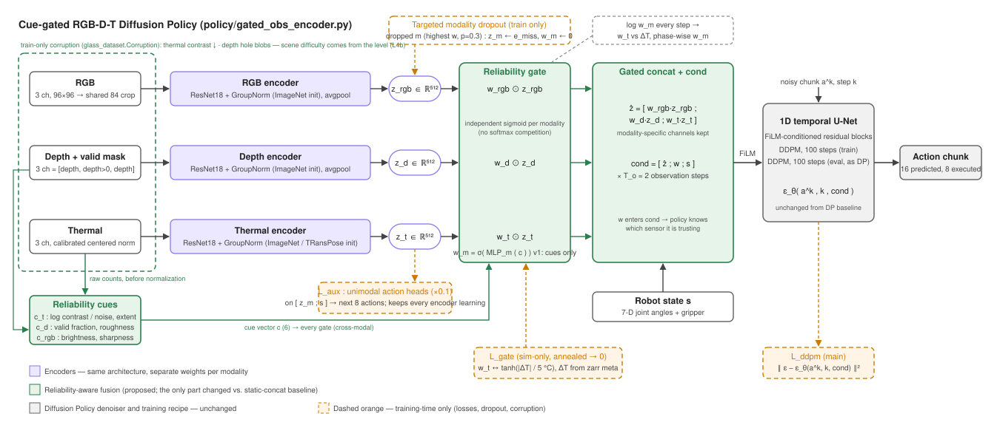

# Cue-driven reliability gating for the RGB-D-T Diffusion Policy

This folder holds the "explicit gate" fusion of the midterm report (ẑ = Σ w_m z_m) in its simplest form: each sensor's
weight is computed from **physical cues** measured on the raw frame, not learned from the image features, and the
rest of Diffusion Policy is untouched. It is one of the two fusion designs the team compares; the other is the
learned attention weighting in `fusion/` (branch `policy/learned-attention-weighting`).



Everything lives in `policy/` and is switched on by config. Static-concat baselines and all ablations are hydra
overrides of one config, so any two runs differ only in the flag that names them.

## Why cues

Thermal fails in one well-defined situation, **thermal crossover**: when the glass and the table have the same
temperature the thermal image contains only sensor noise. The camera cannot see the object at all, so no network can
recover it, and a fusion that keeps trusting thermal there gets a noise pattern as input. The fix needs two things:
the fusion has to *know* when thermal is uninformative, and it has to lower that sensor's weight exactly then.
A per-frame scalar computed from the raw counts does the first part for free:

| modality | cue (policy/obs_util.py) | reads as |
|---|---|---|
| thermal | `log(1 + (p99 - p1) / (4.65 σ_noise))` on the table region; fraction of pixels > 3σ from the median | 0.69 = noise only (crossover), > 2.5 = clear object |
| depth | fraction of pixels with a reading; mean \|Laplacian\| of the readings | holes; wrong-depth blobs (L3b/L4b) |
| rgb | mean brightness; log variance of the Laplacian | low light / noise (L4) |

Cues are computed **before normalization** (the calibrated thermal pipeline would otherwise hide the lost contrast)
and **after training corruption** (so a corrupted frame always comes with the cue that describes it), on the lower
part of the frame where the table is, because the warm robot arm would otherwise make every frame high-contrast.
The gate is `w_m = sigmoid(MLP_m(c))` with the whole 6-vector `c` as input, one independent weight per modality
(no softmax competition), multiplied onto that modality's feature block; `w` itself is appended to the conditioning
so the policy knows which sensors it is currently relying on.

This is the setting QMF (Zhang et al., ICML 2023) describes: dynamic fusion beats static fusion when the weights
anti-correlate with each modality's error, and UDML (Wei et al., 2026) explains why a *learned* reliability estimate
can fail to do that (the harder modality is under-trained, so it looks uncertain, so it gets down-weighted, so it
trains even less). A physical cue is independent of how well the encoder has been trained, which is why it is the v1
default and the learned variants are ablations.

## What is in the code

| file | role |
|---|---|
| `policy/obs_util.py` | depth validity channel (`mask_channel: true`), cue vector `compute_cues`, shared by dataset and eval env |
| `policy/shared_crop_encoder.py` | DP's encoder with **one random crop for all modalities** (DP crops each key independently, so RGB / depth / thermal of a frame were misaligned by up to 12 px) and per-key initial weights (`imagenet` or a state dict, e.g. the TRansPose thermal encoder) |
| `policy/gated_obs_encoder.py` | the gate: cue → w, gated concat, w in cond, learned missing embedding, random / targeted modality dropout, `force_drop` for inference |
| `policy/gated_policy.py` | DP policy + gate warm-start loss (sim thermal gap, annealed to 0) + unimodal auxiliary action heads; records w and cues at inference |
| `policy/glass_dataset.py` | loads `thermal_raw` and `meta/ep_*`, computes cues, online corruption (`Corruption`) |
| `policy/config/task/glass_pick_cue.yaml` | task with mask channel, cue, meta, corruption |
| `policy/config/train_glass_gated_unet_image.yaml` | training config (extends `train_glass_unet_image`) |
| `policy/train_gated.sh` | one command per arm × modality set |
| `policy/eval.py` | `--drop thermal` (sensor off at inference), `--save_w` (weights per step into episodes.json) |
| `policy/test_gating.py` | CPU tests, ~1 min |

With `fusion arm = static` the model is DP's RGB-D-T concat plus the shared crop, mask channel and encoder
initialization. Those three are improvements to the baseline itself, not to the gate, and apply to every arm.

## Runs

All on the L4b demos (`sim/hard-scenario` sweep data), 151 epochs, evaluation every 25 epochs on test set (a),
then `eval.py` on the saved checkpoint for the other columns. GPU per run; the arms are independent.

**T2 — the main comparison (2 × 2).** Same encoders, same data; corruption on/off × gate on/off.

| run | arm | corruption | command |
|---|---|---|---|
| A | static | off | `train_gated.sh static rgbdt $Z task.dataset.augment=null` |
| B | static | on | `train_gated.sh static rgbdt $Z` |
| C | gate | off | `train_gated.sh gate rgbdt $Z task.dataset.augment=null` |
| D | gate | on | `train_gated.sh gate rgbdt $Z` |

B vs D is the claim. C shows what the gate does when it never saw crossover in training.

**T3 — ablations of D** (one flag each; `$ENC=policy.obs_encoder`).

| run | override | question |
|---|---|---|
| D1 | `static_cue` arm | is it the cue *information* or the multiplicative gate? |
| D2 | `gate_feat` arm | learned-only gate (no cue) |
| D3 | `gate_both` arm | hybrid cue + feature |
| D4 | `$ENC.gate_act=softmax` | competing weights |
| D5 | `$ENC.w_in_cond=false` | does the policy use "which sensor I trust"? |
| D6 | `$ENC.missing=zero` | learned missing embedding |
| D7 | `$ENC.dropout_mode=random` | targeted vs random dropout |
| D8 | `policy.aux_weight=0` | unimodal auxiliary heads |
| D9 | `policy.gate_loss_weight=0` | does the gate form without the sim warm start? |

**Modality sets.** `train_gated.sh <arm> rgb|rgbd|rgbt|rgbdt ...` as in `policy/train.sh` (T1).

### Evaluation columns

```bash
E="python policy/eval.py -c $CKPT -o data/eval/$NAME --level L4b --n_test 50"
$E --test_set a_in_distribution --test_set f_crossover --test_set g_heldout_all --save_w
$E --test_set a_in_distribution --drop thermal
$E --test_set a_in_distribution --drop depth
```
Report success on (a) nominal, (f) crossover, (g) held-out scene, and with thermal / depth switched off. The expected
pattern for the gate is "equal on (a), better on (f) and on the dropped-sensor columns"; a gain on (a) alone would
point to the encoder changes, not the gate.

### Analysis from the saved weights

`episodes.json` (with `--save_w`) has, per episode, `thermal_gap`, `is_crossover`, the outcome, and `w` / `cue` at
every decision step. Three plots, no re-running:

1. `w_thermal` vs `|thermal_gap|` (scatter + binned mean), D against D2 and D9: does the gate track crossover, and
   does it still do so without the cue or without the warm start?
2. `w_m` vs the unimodal auxiliary error of modality m (from training logs, `aux_<m>` per step): the QMF condition.
3. mean `w_m` per phase (approach / descend / grasp / lift, from the step index and the gripper command).

## Status

- [x] code + CPU tests (`python -m policy.test_gating`)
- [ ] pipeline check on the L0 release demos (static vs gate, 25 epochs)
- [ ] T1 / T2 on L4b
- [ ] T3
- [ ] plots

## Notes

- `thermal_raw` is needed for the thermal cue. The L0 release zarr (`multi-object-v0.1`) predates it; the cue then
  falls back to the normalized 8-bit image with a warning, which is enough to test the pipeline but not to measure
  the gate. Demos collected from `sim/collect_demos.py` on main have it.
- The cue normalizer is a z-score fitted on clean and corrupted frames, so corrupted cues stay in range.
- The gate warm-start target uses the episode's thermal gap. In episodes with liquid the glass wall below the liquid
  line takes the liquid's temperature, so the gap understates thermal's information there; the loss is annealed to 0
  by epoch ~50 and `D9` checks that the gate forms without it.
- `policy.obs_encoder.init_weights.thermal=<path>` loads the `encoder/thermal_pretrain` export; conv1 is adapted
  from 1 to 3 channels automatically.
