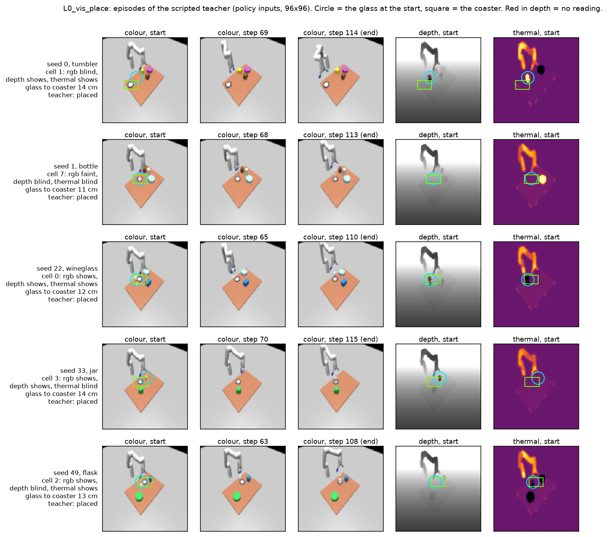

# Pick-and-place on the visibility benchmark: level `L0_vis_place`

Started 11/24 (decision of the user: a harder task than the pick). This file defines the level and records how it was
checked. No demos have been collected and no policy has been trained on it yet; the runs are listed at the end and
wait for a decision.

## Why

On `L0_vis` the task is to pick a glass that stands still and lift it 10 cm. A policy that is given the grasp point
once and no images (`hcg_blind`, [`../cue_gate/README.md`](../cue_gate/README.md)) succeeds as often as one that also
sees the images: after the glass has been found, nothing else has to be seen. Pick-and-place adds a second place that
has to be found, a longer episode (about twice the steps) and a phase in which the glass is carried.

What it does not add: the scene still does not change while the arm moves, so in principle both places can be read
from the first frame. Whether the images matter during the motion is a question for the runs, not something the level
guarantees.

## The level

`sim/configs/L0_vis_place.yaml` (`base: L0_vis.yaml`, `task: place`, meta/ep_level id 36; in
`sim/configs/manifest.json`). 

- **Scene.** The scenes of `L0_vis`, seed for seed: the same glass (tumbler, bottle, wineglass, jar, flask), position,
  visibility cell (eleven cells, same weights), table, light and one to three opaque distractors. One thing is added:
  a coaster. The test sets are the existing ones with the new level, `test_set("L0_vis_place", "j_cells11")` and
  `"k_cells11_heldout"` (660 episodes each, 60 per cell, the same seeds as for `L0_vis`).
- **Coaster.** An opaque disc 12 cm wide and 6 mm thick, fixed to the table (it cannot be pushed away), always with
  the same look: dark with a light centre. Its temperature is within 1 degC of the room. So the colour camera shows
  it in every cell, also in the cells in which the colour camera does not show the glass (there the glass is clear;
  the light is normal); depth (6 mm of height) and thermal hardly show it.
- **Where the coaster is.** A random spot on the near part of the table (x 0.27 to 0.42 m, y -0.28 to 0.28 m, no
  further from the arm's base than the far corners of the region the glass spawns in, 0.446 m, where the top-down IK
  still reaches the carry height), at least 2 cm (edge to edge) from the glass and from every distractor, and such
  that the glass can be carried to it in a straight line without passing over a distractor. It has its own random
  stream and is drawn last, so nothing else in the scene depends on it. Distance from the glass at the start: 11 to
  42 cm, median 15 cm (17 cm in `k_cells11_heldout`).
- **Task and success.** Pick the glass, carry it to the coaster, put it down and let go. Success
  (`GlassPickEnv.placed`), all at once: the glass stands on the coaster's top (within 5 mm in height), upright (leaning
  less than 10 degrees), its footprint entirely inside the coaster (its centre within 2.5 to 3 cm of the coaster's
  centre, depending on the object), at rest, and the tool is 5 cm above the glass's grasp point. The episode ends
  there. For the policy the episode is at most 240 steps (`task.env_runner.max_steps=240`; the pick uses 120).
- **Teacher.** The pick of the pick levels, unchanged (the same random draws), then: carry at the lift height in a
  straight line (about 1 cm per step), down over 12 to 17 steps until the base is 3 mm above the coaster, open for 6
  steps, back up in 12. Episodes are 99 to 142 steps, median 114 (the pick: 55 to 71).
- **Contacts.** The scene of this level (`sim/assets/gen3_lite/place_scene.xml`) uses elliptic friction cones with
  impratio 10. With the settings of the pick levels a held glass creeps down between the fingers while it is carried
  (the tumbler by about 3 cm, median; it then hit the coaster early and fell over in 14 of 60 episodes, the wineglass
  in 2 of 60); with these it stays within 2 mm. The 10 cm lift of the pick levels never showed this. The pick levels are not changed.
- **Failure labels** of an evaluation episode (`policy/glass_gym_env.py`): the labels of the pick when the glass was
  never lifted 10 cm; after that `place_fell`, `place_held`, `place_off`, `place_other`. The episode record also has
  `picked`, `place_offset` (m, at the end) and `coaster_xy`.

## Checks (11/24)

- **Existing levels are unchanged.** `python sim/regression_test.py --check` against arrays saved before the change,
  for the default scene and for `L0_vis` (`--config L0_vis.yaml`): 190 of 190 arrays identical in both (first frames
  of 20 seeds and whole teacher episodes of 5).
- **The teacher solves it.** [`teacher_check.txt`](teacher_check.txt) (`python sim/place_check.py --n 700 --test_set
  j_cells11 --n_test 660`, and the same with `k_cells11_heldout`): 700 of 700 training seeds, 660 of 660 on each test
  set, every object and every cell; no distractor moved. The glass ends 0.2 cm (median; at most 0.4 cm) from the
  coaster's centre.
- **Rare cases of the coaster's position**, seeds 0 to 2999: one seed in which the straight path is not clear, one
  with no free spot at all (the coaster then overlaps a distractor; the teacher fails and the seed is not a demo).
  Test sets: one episode of `j_cells11` without a clear path (the teacher succeeds), none without a free spot.
- **The policy-side env** (`GlassPickGymEnv`, level `L0_vis_place`): with the teacher's actions reward 1 after 106 and
  107 steps; an episode that never lets go is labelled `place_held`, one that puts the glass down 8 cm off
  `place_off`, one that does nothing `timeout`.

## Choices made here that can still be changed (nothing has been trained)

1. The coaster always looks the same and only the colour camera shows it. With a random colour it was hard to see on
   the table when the colours were close, which would have been a difficulty that has nothing to do with glass.
2. Success needs the whole footprint on the coaster (2.5 to 3 cm of tolerance). The grasp needs about 1 cm, so the
   pick stays the harder part.
3. The coaster is fixed to the table and thin; a thicker one would also show in depth.
4. The straight path to the coaster is kept clear, so no obstacle has to be avoided.

## Runs: not started, waiting for a decision

Order as for `L0_vis` (benchmark and baselines before any method):

1. Training demos: 700 from seed 0, as for `L0_vis` (`python sim/collect_demos.py --n 700 --config
   sim/configs/L0_vis_place.yaml --out results/data/sim_demos_L0_vis_place_700.zarr`). About 1.8 times the frames of
   the pick set.
2. Baselines with the protocol of Stage 6 of [`../grid_bench/README.md`](../grid_bench/README.md) (ImageNet encoders,
   101 epochs, last checkpoint, `j_cells11` and `k_cells11_heldout`): rgbdt, rgbd, rgbt, rgb. A run is expected to
   take about twice a pick run (about 7 to 8 hours); one seed each first (4 runs), seeds 43 and 44 after that.
3. The method (hindsight cue gating) on this level is specified after the baselines: the cue of the pick as it is, and
   whether the place gets a cue of its own (the pixel where the gripper opens in the demos) is the open design
   question.

## Files

- `sim/configs/L0_vis_place.yaml`, `sim/assets/gen3_lite/place_scene.xml`, `sim/config.py` (`task`, `place_radius`),
  `sim/env.py` (`_place_target`, `placed`), `sim/teacher.py` (carry and place), `policy/glass_gym_env.py` (labels).
- `sim/place_check.py` (teacher check without rendering the steps), `sim/figure_place.py` (the figure).
