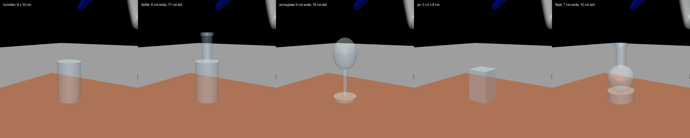
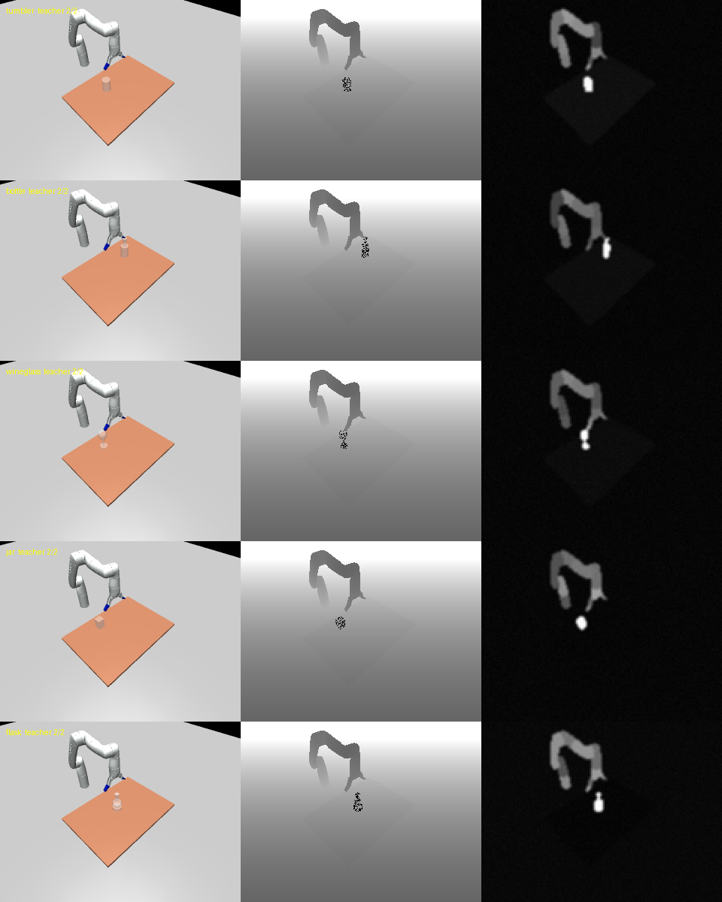
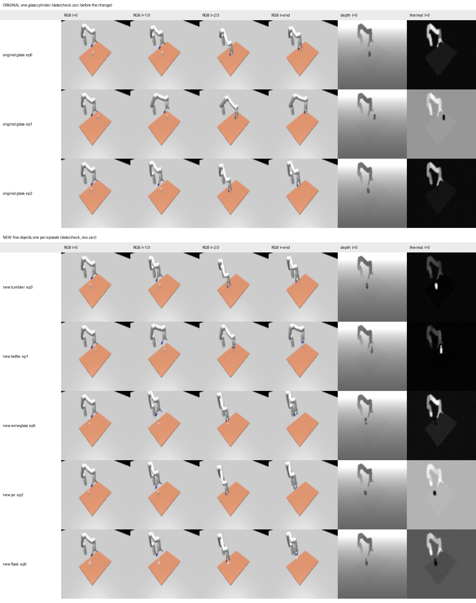

# RGB-only Diffusion Policy on the five-object sim

**Summary.** The sim now has five transparent objects instead of one glass cylinder, one per episode. An RGB-only
Diffusion Policy trained on 500 scripted demos reaches **0.96** success on 50 unseen scenes (10 per object). The task is
still too easy to separate modalities: RGB has to get harder before RGB-D, RGB-T and RGB-D-T runs can show a difference.

The data and the best checkpoint are attached to the GitHub release `multi-object-v0.1`.
`scripts/bridges2/README.md` has the steps to evaluate that checkpoint (about 15 min) or to train from scratch.

## Environment

**Robot and control** are unchanged from PR #2. It is a Kinova Gen3 Lite with 6 joints and a gripper on position
actuators. Control runs at 10 Hz, which is 50 physics steps of 2 ms per action. The camera is the fixed `front_cam`.

**Objects.** There are five glass-like primitives with the old glass material (RGBA 0.8, 0.9, 1.0, alpha 0.2). Every
object geom is in geom group 5, and `sim/sensors.py` uses that group to decide which pixels are transparent.

| Object | Shape | Width | Height | Mass | Teacher grasps at |
|---|---|---|---|---|---|
| tumbler | cylinder (same as the old glass) | 6.0 cm | 10.0 cm | 150 g | 7.0 cm, mid-body |
| bottle | body + 2.6 cm neck + lip | 6.0 cm | 17.0 cm | 235 g | 13.5 cm, neck under the lip |
| wineglass | base + stem + ellipsoid bowl | 6.0 cm | 15.8 cm | 140 g | 10.5 cm, just below the bowl's widest point |
| jar | box | 5.0 cm | 8.0 cm | 150 g | 5.0 cm, mid-body |
| flask | base + sphere + 2.6 cm neck + lip | 7.0 cm | 14.5 cm | 205 g | 11.5 cm, neck under the lip |

Plain cylindrical necks slipped out of the fingers during the lift. That is why the necks have a lip and the wineglass
is held under the bowl's equator.

**Episode setup.** Each reset uses the seed to draw one object uniformly at random. The object stands upright at
x 0.30 to 0.42 m and y -0.15 to 0.15 m. The other four objects are parked on the floor behind the camera, and
`sim/objects_test.py` checks that they never show up in the image. The x range used to be 0.32 to 0.48 m. Beyond about
x = 0.44 m, the top-down IK cannot reach high enough to lift the taller objects 10 cm. Success is unchanged: the object is
lifted 10 cm.

**Sensors.** The logic is unchanged and now applies to any group-5 geom.
- **RGB** is rendered at 320×240 and resized to 96×96.
- **Depth** shows the surface behind the object on transparent pixels, and 40% of those pixels are set to 0 (no
  reading). The range 0 to 2 m maps to 0 to 255.
- **Thermal** gives each object a temperature and emissivity and computes Planck band radiance over 8 to 14 µm. It is
  rendered at 160×120, blurred, given noise, and normalized per frame, so values are relative, not °C. Ambient is 18 to
  26 °C, the table is within ±1 °C of ambient, and the arm is 5 to 12 °C warmer. The object is within ±1 °C of ambient
  (thermal crossover) in 30% of episodes and 5 to 35 °C hotter or colder in the rest.

**Scripted teacher.** It is still mink IK with a top-down grasp: move above the object, descend, close for 8 steps,
lift. The grasp height comes from a per-object table (`OBJECTS` in `sim/env.py`). The pre-grasp and lift height is
16 cm above the grasp point, capped so the tool stays below 0.30 m. The teacher succeeded 20/20 for every object on
random seeds and on a 3×3 grid over the spawn corners. It succeeded 500/500 during data generation.

## Data

| | |
|---|---|
| Episodes | 500 (seeds 0 to 499, no teacher failures) |
| Steps | 31,120 at 10 Hz, 55 to 69 per episode, mean 62 |
| Per object | tumbler 101, bottle 97, wineglass 101, jar 107, flask 94 |
| Generation | about 8.5 min on a MacBook with `--workers 6` |
| File | `sim_demos_5obj.zarr.zip` (489 MB) in the release |

The format is the same Diffusion Policy zarr as before, plus `meta/object_id` (names in the `object_names` attribute of
`meta`). The release has it as a single uncompressed zip store, because Bridges-2's `/ocean` writes the 93k small files
of a zarr directory very slowly. `ReplayBuffer.copy_from_path` opens a path ending in `.zip` directly.

## Training

The model and hyperparameters are the same as in PR #2 (`policy/config/train_glass_unet_image.yaml`). Only the number of
epochs and the number of test episodes changed.

| Setting | Value |
|---|---|
| Inputs | RGB 96×96 (random 84×84 crop) and 7 joint angles, last 2 observation steps |
| Image encoder | ResNet18 from scratch, GroupNorm, one encoder per image modality |
| Denoiser | 1-D conv UNet, channels 512/1024/2048, kernel 5, observations as global conditioning |
| Diffusion | DDPM, 100 steps, squared-cosine schedule, predicts the noise |
| Actions | 6 absolute joint targets + gripper target; predicts 16 steps, executes 8 |
| Optimizer | AdamW, lr 1e-4, weight decay 1e-6, cosine schedule with 500 warmup steps, batch 64, EMA |
| Split | 95/5 by episode: 475 episodes (26,230 windows) for training, 25 (1,390 windows) for validation loss |
| Length | 150 epochs × 410 iterations = 61,500 steps |
| Hardware | 1× V100-16GB on Bridges-2 GPU-shared, 3 h 28 min, about 3.5 SU |

Training loss went from 1.1 to 0.001. Validation loss was 0.0009 at the last epoch.

## Evaluation

**How the policy acts.** Every 0.8 s, the policy takes the last two observations. It starts from Gaussian noise and runs
100 DDPM denoising steps to sample a 16-step action sequence. It executes the first 8 actions open-loop at 10 Hz, then
observes again and replans. Evaluation uses the EMA weights.

**Protocol.** There is no stored test set: the simulator builds each test scene from its seed.
- Evaluation runs every 25 epochs inside the training job, in the same environment code and sensors as the demos.
- The 50 test scenes use seeds 100000 to 100049, far from the demo seeds 0 to 499. The object is the seed modulo 5, so
  each object gets exactly 10 episodes.
- An episode ends on success or after 120 steps (12 s). Success means the object was lifted 10 cm.
- Results are logged as `test/mean_score` and `test/mean_score_<object>`, with videos of 3 test episodes per evaluation.
- Rendering uses EGL on the GPU. On a 16 GB V100 the environments run 18 at a time (`task.env_runner.n_envs=18`), which
  changes only the speed. One evaluation takes about 6 minutes.

`policy/eval.py` (or `scripts/bridges2/eval.sbatch`) runs the same evaluation on a saved checkpoint, and `--test_start_seed`
picks a different range of scenes.

## Results

| Object | ep0 | ep25 | ep50 | ep75 | ep100 | ep125 |
|---|---|---|---|---|---|---|
| bottle | 0/10 | 2/10 | 6/10 | 8/10 | 10/10 | 9/10 |
| flask | 0/10 | 5/10 | 9/10 | 10/10 | 9/10 | 10/10 |
| jar | 0/10 | 3/10 | 8/10 | 10/10 | 10/10 | 10/10 |
| tumbler | 0/10 | 5/10 | 3/10 | 8/10 | 9/10 | 8/10 |
| wineglass | 0/10 | 5/10 | 7/10 | 9/10 | 10/10 | 10/10 |
| **All** | 0.00 | 0.40 | 0.66 | 0.90 | **0.96** | 0.94 |

For reference, PR #2's single-glass RGB run with 200 demos scored 0.40, 0.77 and 0.70 at epochs 25, 50 and 100.

Re-evaluating the released epoch-100 checkpoint on the same 50 scenes, in a fresh environment built with
`scripts/bridges2/setup.sh`, gave **0.94**: tumbler 7/10 and every other object 10/10. The one-episode difference from
0.96 comes from the random noise the policy samples with.
`eval_scores.json` has the same numbers with the losses. The epoch-100 EMA weights are in the release as
`rgb_5obj_epoch100_ema.ckpt` (1.15 GB).

**Takeaways.**
- RGB alone nearly solves the five-object task. It climbs faster per epoch than the single-glass run, because each
  epoch has 2.5× more demos.
- The tumbler is the weakest object in every late evaluation (9, 8 and 7 out of 10, the others 9 or 10). It is the
  plainest shape, a cylinder through which the table shows. Ten episodes per object are still too few to call that a
  real difference.
- At alpha 0.2 the objects contrast strongly with the table in RGB. All four modality combinations will probably land
  near 1.0 again unless RGB gets harder.

## Notes

- **Diffusion Policy evaluates and saves checkpoints only when `epoch % 25 == 0`**, and epochs count from 0. With 150
  epochs the last evaluation is epoch 125 and epochs 126 to 149 are thrown away; PR #2's 300-epoch runs lost epochs 276
  to 299 the same way. `scripts/bridges2/train.sbatch` uses 151 epochs.
- **`policy/glass_runner.py` called `wandb.util.generate_id`**, which recent wandb versions removed. It now uses `uuid`.
- **A full training checkpoint is 4.6 GB** (model, EMA, optimizer). The top 5 plus the latest come to about 27 GB per run.
- **The numpy warning "invalid value encountered in cast" is harmless.** It comes from Diffusion Policy's sampler
  filling unused frames with NaN in uint8 arrays.

## Next steps

1. Make RGB harder: lower and randomize the object alpha, and randomize the table color and lighting. Then check that
   RGB-only success drops.
2. Run rgb, rgbd, rgbt and rgbdt with the same settings. Each takes about 3.5 h and 3.5 SU on a V100.
3. Revisit the thermal temperature gap. In 70% of episodes the object is 5 to 35 °C off ambient, which favors thermal
   more than a glass resting on a table would in reality.
